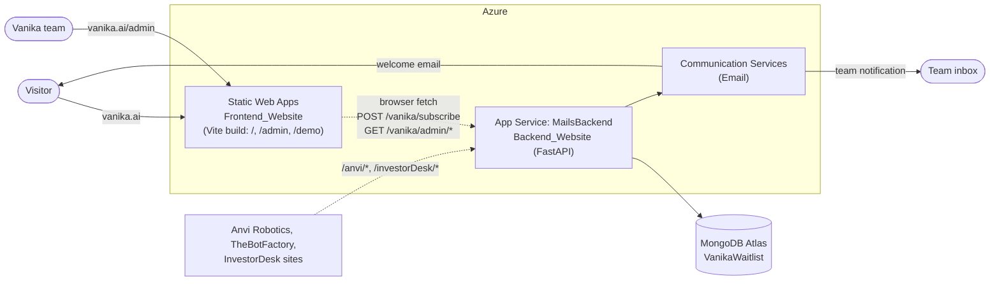
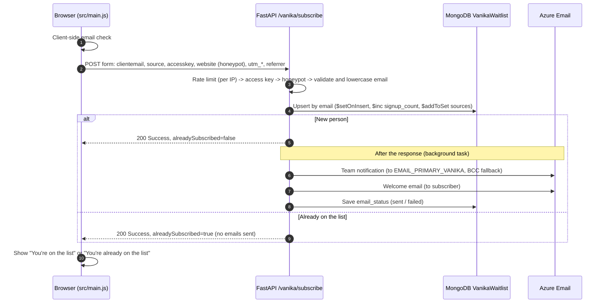
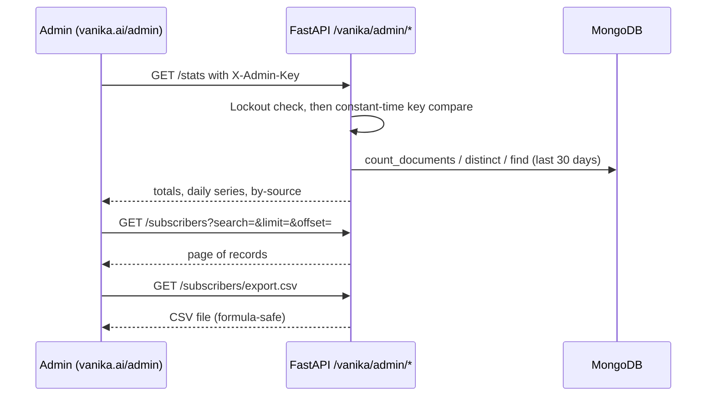

# Architecture — Vanika.AI website & waitlist

| | |
|---|---|
| **Status** | Implemented on branch `V2` |
| **Scope** | vanika.ai marketing site, waitlist capture, waitlist admin dashboard |
| **Related** | [PLAN.md](PLAN.md) (rollout & roadmap), [README](../README.md) (setup) |

## 1. Goals

1. **Every waitlist sign-up is stored**, so the team can see how many people joined, when, and from which form.
   Before V2, sign-ups were only emailed and never saved.
2. **No duplicates.** One record per person, even if they submit twice or use different capitalisation.
3. **The team can retrieve the list** without database access: a dashboard, a CSV export and an API.
4. **Email problems are visible.** Each record shows whether the team notification and welcome email were
   delivered.
5. **No regressions for the other sites** (Anvi Robotics, TheBotFactory, InvestorDesk) that share the same backend.

Non-goals for now: sending launch or invite campaigns, user accounts, and a marketing CRM.

## 2. System context



| Component | Technology | Hosting | Responsibility |
|---|---|---|---|
| Frontend | Static HTML/CSS/JS, Vite 8 | Azure Static Web Apps | Landing page, waitlist forms, admin dashboard UI |
| Backend | FastAPI (Python 3.10) | Azure App Service `MailsBackend` | Validation, storage, email, admin API. **Shared with other sites.** |
| Database | MongoDB Atlas (driver: motor) | Atlas | Waitlist records (`VanikaWaitlist`); InvestorDesk data |
| Email | Azure Communication Services | Azure | Team notification + subscriber welcome email |

The browser talks to the backend directly; there is no server-side rendering. The admin dashboard is a static page,
so all access control happens in the backend through the admin key.

## 3. Key flows

### 3.1 Joining the waitlist



**Error responses** use the shape `{"status": "Failed", "code": ..., "message": ...}`:

| HTTP | `code` | When | What the visitor sees |
|---|---|---|---|
| 422 | `INVALID_EMAIL` | Server-side validation fails | "Please enter a valid email address." |
| 403 | `INVALID_ACCESS_KEY` | `accesskey` doesn't match `VANIKA_ROUTES_KEY` | Generic error |
| 429 | `RATE_LIMITED` | More than `VANIKA_SUBSCRIBE_RATE_LIMIT` attempts/min from one IP | "Too many attempts…" |
| — | (network) | Backend unreachable | "We couldn't reach our server…" |

### 3.2 Viewing the waitlist



The key is kept in `sessionStorage`, so it is cleared when the tab closes. The dashboard renders all data with
`textContent`, never as HTML.

## 4. Data model

**Collection:** `VanikaWaitlist`. The database is `VANIKA_DB_NAME` if set, otherwise `MONGODB_DB_NAME`.

| Field | Type | Set | Meaning |
|---|---|---|---|
| `email` | string | insert | Lowercased, validated address. **Unique.** |
| `created_at` | date (UTC) | insert | First sign-up |
| `last_signup_at` | date (UTC) | every sign-up | Most recent sign-up |
| `signup_count` | int | `$inc` | Times this person submitted a form |
| `first_source` | string | insert | `hero`, `final_cta` or `unknown` (older frontend) |
| `sources` | string[] | `$addToSet` | Every form they used |
| `status` | string | insert | `active` (reserved for a future `unsubscribed`) |
| `metadata` | object | insert | `utm_source`, `utm_medium`, `utm_campaign`, `referrer`, `user_agent`, each only when present |
| `email_status` | object | after send | `{admin, user}`: `pending`, `sent` or `failed` |
| `email_error` | string | after send | Provider error, only when a send failed |

**Indexes:** `email` (unique) and `created_at` (descending). The backend creates them at startup, and the first
sign-up retries if startup creation failed.

Example document:

```json
{
  "email": "priya@robotics-lab.in",
  "created_at": "2026-10-13T12:47:55.875Z",
  "last_signup_at": "2026-10-13T12:47:58.232Z",
  "signup_count": 2,
  "first_source": "hero",
  "sources": ["hero", "final_cta"],
  "status": "active",
  "metadata": { "utm_source": "linkedin", "utm_campaign": "launch" },
  "email_status": { "admin": "sent", "user": "sent" }
}
```

The raw IP address is not stored. It is used only in memory for rate limiting.

## 5. Security model

| Threat | Control | Where |
|---|---|---|
| Bots spamming the form or sending emails to third parties | Honeypot field (fake success), per-IP rate limit, server-side validation, no emails for repeats | `routes.py`, `security.py` |
| IP spoofing to dodge limits | Use the **last** `X-Forwarded-For` hop, which Azure appends | `security.py: client_ip` |
| Unauthorised data access | `X-Admin-Key` with constant-time compare; 10 failures per 5 min locks the IP out (checked *before* the compare) | `security.py: require_admin` |
| HTML injection into team emails | `html.escape` on email and source | `email_templates.py` |
| CSV formula injection | Values starting with `= + - @` are prefixed with `'` | `routes.py: _csv_safe` |
| Cross-site use of the API | Origin firewall + CORS allow-list (`CORS_ORIGINS`) | `main.py` |
| Admin page indexed by search engines | `noindex` meta, `X-Robots-Tag`, robots.txt | `admin.html`, SWA config |

`VANIKA_ROUTES_KEY` / `VITE_MAIL_ACCESS_KEY` ships inside the public JavaScript bundle. It is a light filter, **not a
secret**. The real protections are the controls above.

## 6. Failure behaviour

| Failure | Behaviour | How you notice |
|---|---|---|
| MongoDB not configured | Sign-ups are still emailed to the team, marked "could not be saved"; the dashboard says storage is unavailable | Startup log `[Vanika] [WARN]`, dashboard banner |
| MongoDB error on write | Same as above for that sign-up | Log `[Vanika] [FAIL] Could not store sign-up` |
| Email provider down or misconfigured | Sign-up is stored; `email_status` = `failed` with the reason | Red ✕ in the dashboard "Emails sent" column |
| Two first sign-ups race on the same email | Unique index rejects one; it retries as an update | — |
| Index creation fails at startup | Retried on the next sign-up | Log `[Vanika] [FAIL] Could not ensure waitlist indexes` |
| Backend scaled to several instances | Each instance keeps its own rate-limit window (limit is per instance) | — (acceptable; see Plan) |

## 7. Code layout

```
Backend_Website/
  main.py                    app, lifespan, CORS + origin firewall, router mounting
  config.py                  Settings (env), Mongo client, get_vanika_db(), Azure Blob
  Vanika_Mailing/
    routes.py                /vanika/subscribe + /vanika/admin/* (HTTP layer)
    waitlist.py              WaitlistRepository: upsert, stats, list, export, delete
    security.py              RateLimiter, client_ip, require_admin
    helpers.py               send_email (ACS, run in a worker thread)
    email_templates.py       team + welcome email HTML
  Anvi_Mailing/, Email_Templates/, InvestorDesk/   other sites — unchanged
  tests/                     pytest: in-memory Mongo (mongomock-motor), stubbed email
Frontend_Website/
  index.html  admin.html  demo.html
  src/lib/api.js             single backend client (URL resolution, subscribe, admin requests)
  src/main.js                landing page behaviour
  src/admin.js               dashboard
  src/styles/tokens.css      shared design tokens + accessibility base
  src/styles/site.css        landing page   src/styles/admin.css  dashboard
  public/staticwebapp.config.json   routes (/demo, /admin), headers
.github/workflows/ci.yml           tests + build on every push / PR
.github/workflows/backend-deploy.yml   deploy backend on push to main
docker-compose.dev.yml             local MongoDB
```

**Layering in the backend:** routes (HTTP, validation, auth) → repository (all MongoDB queries) → driver. Routes
never query MongoDB directly. To swap storage, replace `WaitlistRepository`.

## 8. Configuration

| Variable | Component | Required | Notes |
|---|---|---|---|
| `MONGODB_URI` | backend | **yes** (for storage) | Same Atlas cluster as InvestorDesk |
| `MONGODB_DB_NAME` / `VANIKA_DB_NAME` | backend | no | `VANIKA_DB_NAME` puts Vanika data in its own database |
| `VANIKA_WAITLIST_COLLECTION` | backend | no | Default `VanikaWaitlist` |
| `VANIKA_ADMIN_KEY` | backend | **yes** (for dashboard) | Long random string; the admin API is off when empty |
| `VANIKA_ROUTES_KEY` | backend | no | Must equal the frontend's `VITE_MAIL_ACCESS_KEY` |
| `VANIKA_SUBSCRIBE_RATE_LIMIT` | backend | no | Default 5/min per IP |
| `CORS_ORIGINS` | backend | **yes** | Include `https://vanika.ai` and `https://www.vanika.ai` |
| `AZURE_COMMUNICATION_CONNECTION_STRING`, `EMAIL_PRIMARY_VANIKA`, `EMAIL_BCC_FALLBACK_1` | backend | yes (for email) | Sender must be a verified ACS domain address |
| `VITE_API_BASE_URL` | frontend build | **yes** | Backend base URL; legacy `VITE_MAIL_BACKEND_URL` still accepted |
| `VITE_MAIL_ACCESS_KEY` | frontend build | if backend key set | Public |

## 9. Design decisions

| # | Decision | Alternatives considered | Why |
|---|---|---|---|
| D1 | Store sign-ups in **MongoDB Atlas** | New SQL DB, Azure Table Storage, Google Sheets/Airtable | Already provisioned and used by this backend; no new service, credentials or cost |
| D2 | **Upsert keyed by email** | Insert every submission | Count = unique people; repeat submits don't spam the subscriber |
| D3 | **Emails in a background task**, ACS call in a worker thread | Send before responding | The visitor gets an instant response; the ACS SDK is blocking and stalled the server |
| D4 | **Admin dashboard as a static page** on vanika.ai + key-protected API | Admin UI served by the backend; Atlas UI only | Reuses the site design system and build; backend stays a pure API; non-engineers can use it |
| D5 | **Shared admin key** | Per-user accounts / SSO | Small team, read-mostly data; can be replaced by Entra ID / SWA auth later (see Plan) |
| D6 | **In-memory rate limiter** | Redis, Azure Front Door WAF | No new infrastructure; adequate for one instance; revisit if the backend scales out |
| D7 | **Monorepo**, existing folder names kept | Two repos; rename to `frontend/`, `backend/` | One place for the related changes and CI; renaming would break existing deploy settings for no functional gain |
| D8 | Backward-compatible API | Breaking request format | Old and new frontend/backend combinations keep working, so deploy order doesn't matter |

## 10. Known limitations

- The admin key is shared, and there is no audit log of who exported or deleted records.
- The rate limit is per backend instance.
- Python dependencies are unpinned, so each deploy installs the newest versions.
- `motor` is deprecated in favour of PyMongo's async API.
- The `/anvi` templates and InvestorDesk email sending still have the issues fixed for Vanika (no HTML escaping;
  blocking sends).
- There is no unsubscribe link or consent record yet.

Each of these has an item in [PLAN.md](PLAN.md).
