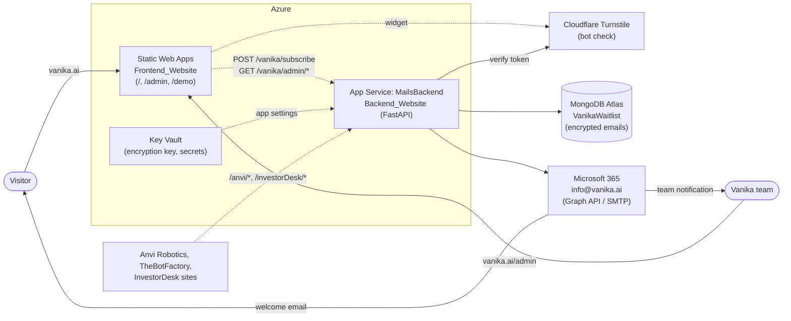
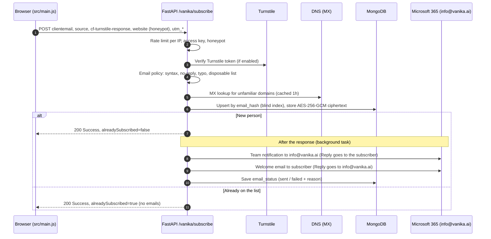
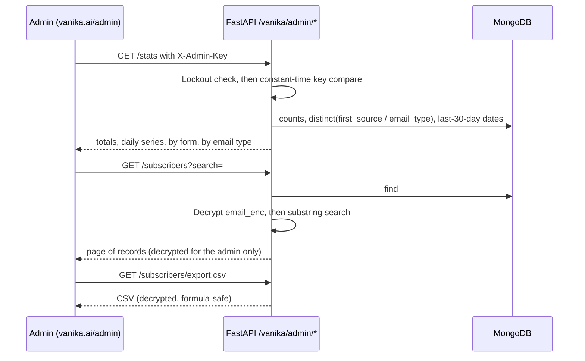

# Architecture — Vanika.AI website & waitlist

| | |
|---|---|
| **Status** | Implemented on branch `V2` |
| **Scope** | vanika.ai marketing site, waitlist capture, waitlist admin dashboard |
| **Related** | [DEPLOYMENT.md](DEPLOYMENT.md) (production runbook), [PLAN.md](PLAN.md) (roadmap), [README](../README.md) (dev setup) |

## 1. Goals

1. **Every waitlist sign-up is stored, encrypted**, so the team can see how many people joined, when, from which form
   and with what kind of address. The addresses themselves are unreadable without the application key.
2. **Only real people with real addresses get in.** Work, school/university and well-known personal addresses are
   accepted. Disposable inboxes, typos, no-reply mailboxes and domains that can't receive mail are rejected. Bots
   are stopped before they reach the database or trigger emails.
3. **No duplicates.** One record per person, even if they submit twice or change capitalisation.
4. **One mailbox for everything:** `info@vanika.ai` sends the welcome email, receives the team notifications, and
   receives subscribers' replies.
5. **The team can retrieve the list** without database access: a dashboard, a CSV export and an API.
6. **No regressions for the other sites** (Anvi Robotics, TheBotFactory, InvestorDesk) that share the backend.

## 2. System context



| Component | Technology | Hosting | Responsibility |
|---|---|---|---|
| Frontend | Static HTML/CSS/JS, Vite 8 | Azure Static Web Apps | Landing page, waitlist forms, admin dashboard UI |
| Backend | FastAPI (Python 3.10) | Azure App Service `MailsBackend` | Validation, spam checks, encryption, storage, email, admin API. **Shared with other sites.** |
| Database | MongoDB Atlas (motor driver) | Atlas | `VanikaWaitlist` (Vanika); InvestorDesk data |
| Email | Microsoft 365 mailbox `info@vanika.ai` | Microsoft | Graph `sendMail` (recommended) or SMTP AUTH (bridge until Dec 2026) |
| Bot check | Cloudflare Turnstile | Cloudflare | Optional invisible challenge on the forms |
| Secrets | Azure Key Vault | Azure | Encryption key, admin key, mail and DB credentials |

## 3. Key flows

### 3.1 Joining the waitlist



**Rejections** return `{"status": "Failed", "code", "message", "suggestion"?}`. The page shows `message`; for a typo
it also offers a one-click fix.

| HTTP | `code` | Trigger | Example |
|---|---|---|---|
| 422 | `INVALID_EMAIL` | Malformed address | `ada@`, `a b@c.com` |
| 422 | `EMAIL_TYPO` | One letter off a major provider, or `.con`/`.co` slips | `ada@outlok.com` → suggests `ada@outlook.com`; the visitor can also choose **Keep my address** |
| 422 | `DISPOSABLE_EMAIL` | Domain (or parent) on the ~9,900-entry disposable list | `x@mailinator.com`, `x@10minutemail.com` |
| 422 | `ROLE_EMAIL` | System mailbox, not a person | `noreply@…`, `postmaster@…` |
| 422 | `UNDELIVERABLE_DOMAIN` | No MX/A record, or null MX | `ada@example.com`, non-existent domains |
| 422 | `PERSONAL_EMAIL_NOT_ALLOWED` | Only with `VANIKA_EMAIL_POLICY=work_or_school` | `ada@gmail.com` |
| 403 | `BOT_CHECK_FAILED` | Turnstile token missing/invalid (when enabled) | Scripted posts |
| 403 | `INVALID_ACCESS_KEY` | `accesskey` ≠ `VANIKA_ROUTES_KEY` | — |
| 429 | `RATE_LIMITED` | More than `VANIKA_SUBSCRIBE_RATE_LIMIT`/min from one IP | — |

**Email type** is recorded for every accepted address:

| Type | Rule | Examples |
|---|---|---|
| `education` | `.edu`, `.edu.xx`, `.ac.xx`, `.sch.xx`, `.k12.xx.us` | `iitb.ac.in`, `stanford.edu`, `ox.ac.uk` |
| `personal` | Curated list of well-known providers | Gmail, Outlook/Hotmail, Yahoo, iCloud, Proton, Zoho, Rediff… |
| `work` | Everything else that passes the checks | `tcs.com`, `anvi.co` |

### 3.2 Viewing the waitlist



## 4. Data model

**Collection:** `VanikaWaitlist`. The database is `VANIKA_DB_NAME` if set, otherwise `MONGODB_DB_NAME`.

| Field | Type | Set | Meaning |
|---|---|---|---|
| `email_hash` | string (hex) | insert | HMAC-SHA256 blind index of the normalised address. **Unique.** Used for dedupe, lookup and delete. |
| `email_enc` | string | insert | `v1:` + base64(nonce ‖ AES-256-GCM ciphertext ‖ tag) of the address. `email_hash` is bound as associated data, so a ciphertext moved to another record will not decrypt. |
| `email_domain` | string | insert | Domain part, kept in plaintext for statistics (e.g. how many from one company) |
| `email_type` | string | insert | `work`, `education` or `personal` |
| `key_version` | string | insert | Encryption scheme version (`v1`) |
| `created_at` / `last_signup_at` | date (UTC) | insert / every sign-up | First and most recent sign-up |
| `signup_count` | int | `$inc` | Times this person submitted a form |
| `first_source` / `sources` | string / string[] | insert / `$addToSet` | `hero`, `final_cta` (or `unknown` from older frontends) |
| `status` | string | insert | `active` (reserved: `unsubscribed`) |
| `metadata` | object | insert | `utm_source`, `utm_medium`, `utm_campaign`, `referrer`, `user_agent`, each when present |
| `email_status` | object | after send | `{admin, user}`: `pending`, `sent` or `failed` |
| `email_error` | string | after send | Provider error when a send failed |

**Indexes:** `email_hash` (unique), `created_at` (desc). Created at startup and retried on the first sign-up. The
legacy `email_1` index from pre-encryption builds is dropped, and plaintext records are encrypted in place, automatically.

```json
{
  "email_hash": "3f9c…e1",
  "email_enc": "v1:Gx2…Qw==",
  "email_domain": "robotics-lab.in",
  "email_type": "work",
  "key_version": "v1",
  "created_at": "2026-10-13T12:47:55.875Z",
  "signup_count": 2,
  "first_source": "hero",
  "sources": ["hero", "final_cta"],
  "status": "active",
  "metadata": { "utm_source": "linkedin" },
  "email_status": { "admin": "sent", "user": "sent" }
}
```

The raw IP address is never stored. It is used only in memory for rate limiting.

## 5. Security model

### 5.1 Encryption

| Layer | Mechanism |
|---|---|
| Browser ↔ site | HTTPS only (Azure SWA), HSTS `max-age=31536000; includeSubDomains` |
| Browser ↔ API | HTTPS only (App Service *HTTPS Only*, TLS ≥ 1.2), HSTS on every API response |
| API ↔ MongoDB | TLS (`mongodb+srv`), Atlas encryption at rest |
| **Stored email addresses** | **Application-level AES-256-GCM** (authenticated, random 96-bit nonce per value). Keys are derived with HKDF-SHA256 from `VANIKA_ENCRYPTION_KEY`, kept in Key Vault. A database leak or backup copy alone does not reveal addresses. |
| Lookups without decryption | HMAC-SHA256 blind index (separate HKDF-derived key) |
| API ↔ Microsoft 365 | Graph over HTTPS with OAuth client credentials, or SMTP STARTTLS on 587 with certificate verification |
| Secrets | Key Vault / App Service settings and GitHub secrets only; `.env` is gitignored |

### 5.2 Abuse and access controls

| Threat | Control | Where |
|---|---|---|
| Bots / scripted sign-ups | Turnstile (optional), honeypot field (fake success), per-IP rate limit | `security.py`, `routes.py`, `src/main.js` |
| Fake or throwaway addresses | Disposable-domain list, MX check, typo catch, no-reply check | `email_policy.py` |
| Using the form to email third parties | All of the above; no emails for repeats | `routes.py` |
| IP spoofing to dodge limits | Use the **last** `X-Forwarded-For` hop (appended by Azure) | `security.py` |
| Unauthorised data access | `X-Admin-Key`, constant-time compare, 10 failures / 5 min lockout checked before the compare | `security.py` |
| HTML injection into team emails | `html.escape` on every interpolated value | `email_templates.py` |
| CSV formula injection | Cells starting with `= + - @` are prefixed with `'` | `routes.py` |
| Cross-site use of the API | Origin firewall + CORS allow-list | `main.py` |
| Admin page discovery | `noindex`, `X-Robots-Tag`, robots.txt, `Cache-Control: no-store` | `admin.html`, SWA config |

## 6. Failure behaviour

| Failure | Behaviour | How you notice |
|---|---|---|
| `MONGODB_URI` or `VANIKA_ENCRYPTION_KEY` missing/invalid | Storage disabled; sign-ups still emailed to the team with a "could not be saved" warning | Startup log `storage disabled (<reason>)`, dashboard banner |
| MongoDB write error | Same as above for that sign-up | Log `Could not store sign-up` |
| Mail transport fails (expired secret, SMTP disabled) | Sign-up stored; `email_status` = `failed` with the reason | ✕ in the dashboard (hover for the reason), log `[MAIL ERROR]` |
| DNS resolver timeout | Address is allowed (no false rejections) | Log `DNS check failed … allowing` |
| Cloudflare unreachable | Turnstile check skipped; rate limits still apply | Log `Turnstile verification unavailable` |
| Wrong encryption key after a change | Records still listed; email shows "(cannot decrypt …)" | Dashboard |

## 7. Code layout

```
Backend_Website/
  main.py                    app, lifespan, CORS + origin firewall, HSTS
  config.py                  Settings (env), Mongo client, get_vanika_db()
  Vanika_Mailing/
    routes.py                /vanika/subscribe + /vanika/admin/* (HTTP layer)
    email_policy.py          who may join: syntax, typo, disposable, role, MX, email type
    data/disposable_domains.txt   CC0 blocklist (refresh: update_disposable_domains.py)
    crypto.py                AES-256-GCM field encryption + HMAC blind index
    waitlist.py              WaitlistRepository: encrypted upsert, stats, list, export, delete
    security.py              rate limiter, client IP, admin auth, Turnstile verify
    mailer.py                Microsoft 365 mail: Graph / SMTP (/ legacy ACS)
    email_templates.py       team + welcome email HTML
  Anvi_Mailing/, Email_Templates/, InvestorDesk/   other sites — unchanged
  tests/                     pytest (37): in-memory Mongo, fake DNS, stubbed mail
Frontend_Website/
  src/lib/api.js             backend client
  src/main.js                landing page: forms, Turnstile, typo fix
  src/admin.js               dashboard
  src/styles/                tokens.css, site.css, admin.css
.github/workflows/           ci.yml, backend-deploy.yml, frontend-deploy.yml
docs/                        ARCHITECTURE.md, DEPLOYMENT.md, PLAN.md
```

**Backend layering:** routes (HTTP, auth, orchestration) → policy / crypto / mailer (pure services) → repository
(all MongoDB access) → driver.

## 8. Configuration

The full annotated list is in `Backend_Website/.env.example` and `Frontend_Website/.env.example`. Production values
are covered in [DEPLOYMENT.md](DEPLOYMENT.md#5-azure-backend-app-service-mailsbackend).

| Variable | Required | Secret | Purpose |
|---|---|---|---|
| `MONGODB_URI` | yes | yes | Storage |
| `VANIKA_ENCRYPTION_KEY` | yes | **yes, back it up** | Email encryption; storage is off without it |
| `VANIKA_ADMIN_KEY` | yes | yes | Dashboard / admin API |
| `GRAPH_TENANT_ID`, `GRAPH_CLIENT_ID`, `GRAPH_CLIENT_SECRET` | one transport | secret: yes | Mail via Microsoft Graph |
| `SMTP_PASSWORD` (+ `SMTP_*`) | one transport | yes | Mail via SMTP (until Dec 2026) |
| `VANIKA_MAIL_FROM`, `VANIKA_TEAM_INBOX` | no | no | Both default to `info@vanika.ai` |
| `VANIKA_EMAIL_POLICY` | no | no | `standard` / `work_or_school` |
| `TURNSTILE_SECRET_KEY` + `VITE_TURNSTILE_SITE_KEY` | recommended | secret key: yes | Bot check |
| `CORS_ORIGINS` | yes | no | Must include vanika.ai origins |
| `VITE_API_BASE_URL` | yes | no | Frontend → backend URL |

## 9. Design decisions

| # | Decision | Alternatives considered | Why |
|---|---|---|---|
| D1 | Store sign-ups in **MongoDB Atlas** | New SQL DB, Table Storage, Sheets/Airtable | Already provisioned for this backend; no new service |
| D2 | **Upsert keyed by a blind index** | Insert every submission | Count = unique people; repeats don't spam |
| D3 | **Emails in a background task** | Send before responding | Instant response; slow providers don't block visitors |
| D4 | **Static admin page** + key-protected API | Backend-served UI; Atlas UI only | Reuses the site design; usable by non-engineers |
| D5 | Shared admin key | Per-user SSO | Small team; upgrade path in PLAN (H4) |
| D6 | In-memory rate limiter | Redis / Front Door WAF | No new infrastructure at one instance |
| D7 | Monorepo, existing folder names | Two repos; renames | One CI; existing deploy settings keep working |
| D8 | Backward-compatible API | Breaking change | Deploy order doesn't matter |
| D9 | **Application-level AES-256-GCM** for addresses, on top of Atlas at-rest encryption | Atlas encryption only; MongoDB Queryable Encryption (CSFLE) | Protects against DB credential leaks and copied backups. Automatic CSFLE / Queryable Encryption needs MongoDB's crypt_shared library plus a KMS provider: more moving parts than this dataset warrants. |
| D10 | **Microsoft 365 via Graph** (SMTP as a bridge) | Keep Azure ACS; SMTP only | Sends from the real `info@vanika.ai` mailbox, so replies land there. Microsoft retires SMTP basic auth (default-off end of Dec 2026). |
| D11 | **Policy-based email acceptance** (disposable list + MX + typos) with an optional work/school-only mode | Third-party verification API (ZeroBounce etc.); work-only by default | No per-check cost or third-party data sharing. Blocking Gmail by default would turn away many real engineers and students; the strict mode is one setting. |
| D12 | **Turnstile** for bot checks | reCAPTCHA, hCaptcha | Free, privacy-friendly, usually invisible |

## 10. Known limitations

- The encryption key cannot be rotated in place; rotation means export and re-import (DEPLOYMENT → Operations).
- Admin search decrypts all records per query. That's fine at waitlist scale (tens of thousands); revisit beyond that.
- The disposable-domain list must be refreshed periodically (monthly script).
- The admin key is shared, and there is no audit log.
- The rate limit is per backend instance.
- `motor` is deprecated in favour of PyMongo's async API.
- The `/anvi` templates and InvestorDesk email sending still lack the Vanika fixes (escaping; blocking sends).
- There is no unsubscribe link or consent record yet.

Each of these has an item in [PLAN.md](PLAN.md).
