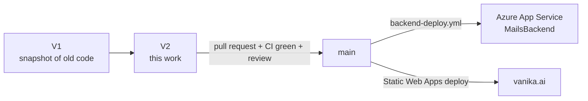

# Plan — waitlist go-live and roadmap

| | |
|---|---|
| **Branch** | `V2` (the original code is preserved untouched on `V1`) |
| **Design** | [ARCHITECTURE.md](ARCHITECTURE.md) |
| **Last updated** | 2026-10-13 |

## Where things stand

| Area | State |
|---|---|
| Waitlist storage (MongoDB), dedupe, email status tracking | ✅ Built, tested (22 backend tests), verified end-to-end against a real MongoDB |
| Admin dashboard `/admin` + API + CSV export | ✅ Built, verified in desktop / mobile, light / dark |
| Backend bug fixes (CORS 500s, validation, blocking email, BCC) | ✅ Done |
| Landing page UX / accessibility fixes, code moved to `src/` | ✅ Done |
| CI (tests + build on every push) | ✅ Green on `V2` |
| **Live on vanika.ai** | ❌ Not yet. See Phase 1 |

## Branch & release workflow

1. Day-to-day work happens on a feature branch off `V2` (later, off `main`), with a PR back.
2. CI (`ci.yml`) must pass: backend tests on Python 3.10 and the frontend build.
3. Merging to `main` deploys the backend automatically once the Azure secrets are added (Phase 1, step 4).
   **Note:** this backend also serves the Anvi Robotics, TheBotFactory and InvestorDesk sites.
4. Keep `V1` as the reference / rollback point. Don't commit to it.

---

## Phase 1 — Go live (target: 1–2 days)

Owner for each step: **TBD**. Deploy the backend first. The API is backward compatible, so the old frontend keeps
working against the new backend while the frontend rollout catches up.

### 1. Database
- [ ] Confirm `MONGODB_URI` is already set on the `MailsBackend` App Service (InvestorDesk uses it).
- [ ] Decide where Vanika data lives (see Decision 1). If it gets its own database, set `VANIKA_DB_NAME` and make sure
      the Atlas user can write to it.
- [ ] Atlas → Network Access allows the App Service outbound IPs (already true if InvestorDesk works).

### 2. Backend settings (Azure Portal → MailsBackend → Configuration)
- [ ] `VANIKA_ADMIN_KEY`: generate with `python -c "import secrets; print(secrets.token_urlsafe(32))"` and store it in
      the team password manager.
- [ ] `CORS_ORIGINS` includes `https://vanika.ai,https://www.vanika.ai` alongside the existing Anvi origins. Keep the
      comma-separated format; spaces are now tolerated.
- [ ] `JWT_SECRET` is set to a strong value. The backend now logs a warning when it's empty or the default.
- [ ] Confirm `AZURE_COMMUNICATION_CONNECTION_STRING`, `EMAIL_PRIMARY_VANIKA`, `EMAIL_BCC_FALLBACK_1` are set, and
      that `EMAIL_PRIMARY_VANIKA` is a verified ACS sender.

### 3. Frontend build settings (Static Web Apps)
- [ ] `VITE_API_BASE_URL` = the MailsBackend URL (no trailing slash). The old `VITE_MAIL_BACKEND_URL` also works.
- [ ] `VITE_MAIL_ACCESS_KEY` = the same value as the backend's `VANIKA_ROUTES_KEY`, if one is set.
- [ ] Confirm how the site is deployed today. There was no deploy workflow in the old frontend repo. Either connect
      the SWA resource to this repo (app location `Frontend_Website`, output `dist`) or keep the current method.

### 4. Deployment pipeline
- [ ] In Azure, add a federated credential for this repo (subject `repo:adityapuppala1/Vanika_Ai_Website:ref:refs/heads/main`).
- [ ] Add repo secrets `AZURE_CLIENT_ID`, `AZURE_TENANT_ID`, `AZURE_SUBSCRIPTION_ID`.
- [ ] Agree that this repo, not `AvanikaGyanaji/Anvi_Mail_backend_main`, now deploys MailsBackend. Disable the old
      repo's workflow so the two don't overwrite each other.

### 5. Release
- [ ] Open a PR `V2 → main`, review, merge. The backend deploys.
- [ ] Deploy the frontend.

### 6. Verify in production (15 min)
- [ ] `GET https://<backend>/vanika/ping` → 200.
- [ ] Startup log shows `[Vanika] [OK] Waitlist indexes ensured.` and **no** `MongoDB not configured` warning.
- [ ] Sign up on vanika.ai with a test address → "You're on the list", plus both emails arrive.
- [ ] Sign up again with the same address → "You're already on the list", and no new emails.
- [ ] `vanika.ai/admin` → sign in → the test record shows with ✓ Team · ✓ Welcome. Export CSV works.
- [ ] Remove the test record from the dashboard.
- [ ] Spot-check the other sites: one Anvi contact form and an InvestorDesk OTP login still work.

### Rollback
- **Backend:** redeploy the previous build (Azure → Deployment Center), or deploy `V1`. Waitlist data already in
  MongoDB is unaffected.
- **Frontend:** redeploy the previous SWA build. The new frontend also works against the old backend.

---

## Phase 2 — Hardening (next 2–4 weeks)

| # | Item | Why | Size |
|---|---|---|---|
| H1 | **Pin Python dependencies** (`pip-compile` / lock file) | Unpinned deps mean any deploy can pull a breaking FastAPI/Starlette/pydantic release | S |
| H2 | **Monitoring**: Application Insights on MailsBackend; alert on `[ACS EMAIL ERROR]` and `Could not store sign-up` | Today failures are visible only in the dashboard and logs | S |
| H3 | Apply the Vanika fixes to `/anvi`: HTML-escape template inputs, send email in a worker thread, validate emails | The same injection and blocking issues exist there | M |
| H4 | Replace the shared admin key with **SWA authentication / Entra ID** roles for `/admin` | Per-person access, revocation, audit | M |
| H5 | Migrate `motor` → PyMongo async API | motor is deprecated | M |
| H6 | Shared rate limiting (Redis or Front Door WAF) **if** the backend scales beyond one instance | The in-memory limit is per instance | M |
| H7 | Backend README cleanup + split `Backend_Website/README` (dependency notes) into docs | Housekeeping | S |

## Phase 3 — Product (backlog, prioritise with the team)

| # | Item | Notes |
|---|---|---|
| P1 | **Import pre-V2 sign-ups** from the team inbox | Earlier sign-ups were only emailed. Export the addresses to CSV and run a one-off import (sets `first_source = "legacy_import"`). |
| P2 | **"What are you building?"** optional field on the Request access form | The section copy asks for it but there's nowhere to type it; store it as `note` |
| P3 | **Unsubscribe link + consent timestamp** in the welcome email | Needed before sending launch / invite emails at scale; `status` already reserves `unsubscribed` |
| P4 | **Early-access invites**: select people in the dashboard → send an invite email → track `invited_at` | Turns the waitlist into the alpha cohort pipeline |
| P5 | Founder names/photos on the landing page | The founder cards are anonymous; JSON-LD names Nihitha Yedla |
| P6 | Privacy-friendly site analytics (visits → sign-up conversion) | UTM + source are captured already |
| P7 | Decide the future of `/demo` | It calls the Anthropic API directly from the browser with a visitor-supplied key; fine as a prototype, not as a product |

## Decisions needed from the team

1. **Same database or separate?** Put Vanika's waitlist in InvestorDesk's database (`investor_db`, simplest), or in
   its own database via `VANIKA_DB_NAME` (cleaner separation, needs Atlas permissions).
2. **Which repo deploys MailsBackend from now on?** Two repos deploying the same app will overwrite each other.
3. **Who holds the admin key**, and where is it stored?
4. **Contact address:** `hello@vanika.ai` vs `nihitha.yedla@vanika.ai`. V2 uses the latter everywhere; confirm
   whether `hello@` exists.
5. **Priority order for Phase 3**, especially P1 (import old sign-ups) and P3 (unsubscribe) before any launch
   email.
