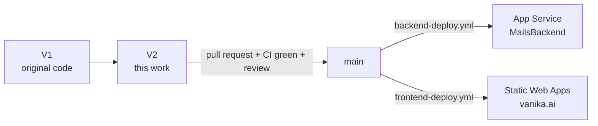

# Plan — waitlist go-live and roadmap

| | |
|---|---|
| **Branch** | `V2`, in both `adityapuppala1/Vanika_Ai_Website` and `PraviDasAnvi/Vanika-Main-Website`. The original code is preserved on `V1`. |
| **Design** | [ARCHITECTURE.md](ARCHITECTURE.md) |
| **How to deploy** | [DEPLOYMENT.md](DEPLOYMENT.md) |
| **Last updated** | 2026-10-13 |

## Where things stand

| Area | State |
|---|---|
| Waitlist storage, dedupe, email-status tracking | ✅ Built and tested |
| **Encryption of stored addresses** (AES-256-GCM + blind index) | ✅ Built and tested |
| **Spam protection** (disposable list, MX check, typos, no-reply, honeypot, rate limit, optional Turnstile) | ✅ Built; verified against real DNS |
| **Email from/to `info@vanika.ai`** via Microsoft 365 (Graph or SMTP) | ✅ Built; live send verified only if the end-to-end run passed (see the V2 commit history) |
| Admin dashboard `/admin` + CSV export, email-type breakdown | ✅ Built |
| Backend bug fixes, pinned dependencies, HSTS | ✅ Done |
| CI + backend and frontend deploy workflows | ✅ Ready (need secrets, see DEPLOYMENT §7) |
| **Live on vanika.ai** | ❌ Not yet. See Phase 1 |

## Branch & release workflow

- Work on a feature branch, then open a PR into `main`. CI must pass and someone must review. Merging deploys.
- **Pick one repository as the deployment source** (Decision 1). The other is a mirror and gets no deploy secrets.
- `V1` is the frozen reference and rollback point.

---

## Phase 1 — Go live (target: this week)

Full instructions are in [DEPLOYMENT.md](DEPLOYMENT.md). Owner for each step: **TBD**.

- [ ] **Change the `info@vanika.ai` password.** It was shared in plain text during setup.
- [ ] Generate `VANIKA_ENCRYPTION_KEY`, `VANIKA_ADMIN_KEY` and `JWT_SECRET`. Store them in Key Vault and the password
      manager. **Back up the encryption key in two places.** (§1)
- [ ] Set up mail (§2):
  - **SMTP now**, to go live quickly.
  - **Graph app registration before December 2026.** That's when Microsoft switches SMTP basic auth off by default.
- [ ] Turnstile widget + keys (§3).
- [ ] Atlas user, network access, backups (§4).
- [ ] App Service settings with Key Vault references, HTTPS Only, TLS 1.2 (§5).
- [ ] SWA custom domains + deployment token (§6).
- [ ] GitHub secrets and variables in the chosen repo; protect `main` (§7).
- [ ] PR `V2 → main`, merge, watch both deploy workflows (§8).
- [ ] Production verification checklist (§9). Spot-check the Anvi and InvestorDesk sites too.

Rollback: DEPLOYMENT §10.

## Phase 2 — Hardening (next 2–4 weeks)

| # | Item | Why | Size |
|---|---|---|---|
| H1 | ~~Pin Python dependencies~~ | Done in V2 | — |
| H2 | **Switch mail to Microsoft Graph**, scoped to `info@vanika.ai` | SMTP basic auth is default-off from end of Dec 2026 | S |
| H3 | Application Insights + alerts on `[MAIL ERROR]` / `Could not store sign-up` | Failures are otherwise visible only in the dashboard | S |
| H4 | Replace the shared admin key with Entra ID / SWA auth roles for `/admin` | Per-person access, revocation, audit trail | M |
| H5 | Apply the Vanika fixes to `/anvi` (escaping, non-blocking mail, validation) | Same issues exist there | M |
| H6 | Monthly job: refresh the disposable-domain list (PR) | New throwaway services appear constantly | S |
| H7 | Migrate `motor` → PyMongo async API | motor is deprecated | M |
| H8 | Shared rate limiting (Redis / Front Door WAF) if the backend scales out | The in-memory limit is per instance | M |
| H9 | Content-Security-Policy for `/` and `/admin` | Defence in depth; `/demo` needs its own policy | S |

## Phase 3 — Product (backlog, prioritise with the team)

| # | Item | Notes |
|---|---|---|
| P1 | **Import pre-V2 sign-ups** from the `info@` / old team inboxes | Export the addresses to CSV, then run a one-off import through the same policy + encryption (`first_source = "legacy_import"`) |
| P2 | Optional **"What are you building?"** field on the Request access form | The section copy asks for it |
| P3 | **Unsubscribe link + consent timestamp** | Required before any launch / invite emails |
| P4 | **Early-access invites** from the dashboard (`invited_at`) | Turns the waitlist into the alpha pipeline |
| P5 | Founder names/photos on the landing page | The cards are anonymous today |
| P6 | Privacy-friendly analytics (visit → sign-up conversion) | UTM + form source are captured already |
| P7 | Decide the future of `/demo` | It calls the Anthropic API from the browser with a visitor-supplied key |

## Decisions needed from the team

1. **Which repository deploys?** `adityapuppala1/Vanika_Ai_Website` or `PraviDasAnvi/Vanika-Main-Website`. Also retire
   the old backend repo's deploy workflow.
2. **Email policy:** `standard` (work + school + Gmail-style providers, the default) or `work_or_school` only.
3. **Same database or separate** (`VANIKA_DB_NAME`) for Vanika data.
4. **Who holds the admin and encryption keys**, and where the encryption-key backups live.
5. **Phase 3 order**, in particular P1 (import old sign-ups) and P3 (unsubscribe) before any launch email.

Resolved: the contact and sending address is **`info@vanika.ai`** everywhere.
